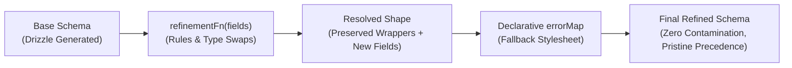
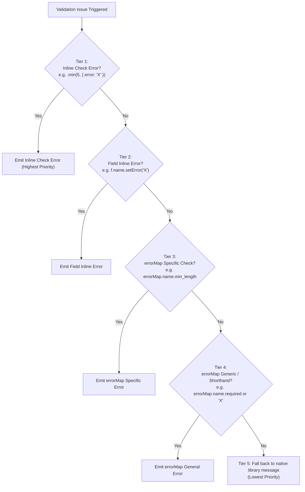
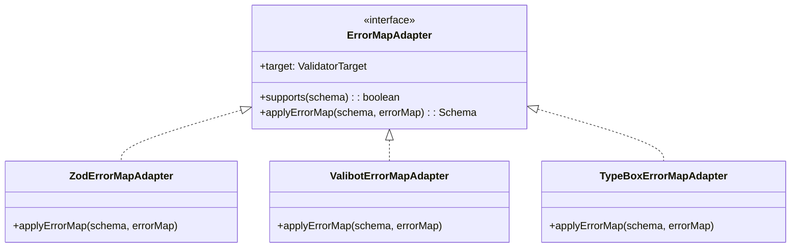

# Architecture & Implementation Plan: Declarative, Type-Safe Error Handling in `refineSchema`

> **Target Package:** `@vacuus/drizzle-validators`  
> **Target Modules:** `packages/drizzle-validators/src/refine.ts`, `packages/drizzle-validators/src/zod-compat.ts`, `packages/drizzle-validators/src/types.ts`, `packages/drizzle-validators/src/adapters/`  
> **Supported Ecosystems:** Zod 4 (`zod@^4.4.3`), Valibot (`valibot@^1.5.0`), TypeBox (`typebox@1.1.0`)  
> **Status:** Proposal / Architectural Specification  

---

## 0. Executive Summary

`@vacuus/drizzle-validators` enables build-time virtual schema generation from Drizzle ORM tables directly into client-side validation libraries with zero drizzle runtime dependencies reaching client bundles. 

Today, while `refineSchema(baseSchema, refinementFn)` empowers developers to mutate shapes, alter types via `.as(...)`, and set inline errors via `.setError(...)`, configuring comprehensive user-facing validation errors remains imperative and repetitive. Form libraries, UI components, and API validation layers require a **declarative, type-safe error-mapping system** that acts like a clean CSS stylesheet:
1. It applies customized default messages across fields and constraints.
2. It allows inline errors (specified directly on checks or fields) to always take precedence.
3. It preserves our strict **C1 non-contamination guarantee** (mutating zero shared schema definitions).
4. It works consistently across **all validation targets** supported by the monorepo (`zod`, `valibot`, `typebox`).

This specification designs two new overload patterns for `refineSchema`:
1. **Error Map Only:** `refineSchema(baseSchema, errorMap)`
2. **Rules Callback + Fallback Error Map:** `refineSchema(baseSchema, refinementFn, errorMap)`

Through strict left-to-right parameter ordering `(schema, refinementFn, errorMap)`, TypeScript infers callback-added fields and type mutations *before* contextualizing the `errorMap`, ensuring complete compile-time autocomplete and safety.



---

## 1. Public API & Ergonomic Usage Specification

### 1.1 Overload Signatures

The new API introduces two new overload signatures while retaining complete backwards compatibility with the existing callback-only signature:

```typescript
// Overload 1: Error map only (no shape modifications)
export function refineSchema<
    TBase extends z.ZodObject<any>,
    TErrorMap extends SchemaErrorMap<TBase["shape"]>,
>(
    baseSchema: TBase,
    errorMap: TErrorMap,
): z.ZodObject<TBase["shape"]>;

// Overload 2: Rules callback only (existing signature)
export function refineSchema<
    TBase extends z.ZodObject<any>,
    RCallback extends RefinementCallbackResult<TBase["shape"]>,
>(
    baseSchema: TBase,
    refinementFn: (fields: RefinableShape<TBase["shape"]>) => RCallback,
): z.ZodObject<ResolvedShape<TBase["shape"], RCallback>>;

// Overload 3: Rules callback + Fallback error map
export function refineSchema<
    TBase extends z.ZodObject<any>,
    RCallback extends RefinementCallbackResult<TBase["shape"]>,
    TErrorMap extends SchemaErrorMap<ResolvedShape<TBase["shape"], RCallback>>,
>(
    baseSchema: TBase,
    refinementFn: (fields: RefinableShape<TBase["shape"]>) => RCallback,
    errorMap: TErrorMap,
): z.ZodObject<ResolvedShape<TBase["shape"], RCallback>>;
```

---

### 1.2 Practical Examples

#### Pattern 1: Declarative Error Map Only (`refineSchema(baseSchema, errorMap)`)
Ideal for standard database schemas where fields, types, and database bounds (`varchar(255)`, `notNull()`, etc.) are already correct, but default generic errors must be replaced with branded UI copy:

```typescript
import { insertUsersSchema } from "virtual:drizzle-validators/users";
import { refineSchema } from "@vacuus/drizzle-validators/refine";

export const createAccountSchema = refineSchema(insertUsersSchema, {
  // String shorthand: sets both `required` and `invalid_type`
  username: "Username is mandatory",

  // Granular check mapping
  email: {
    required: "Please provide your corporate email",
    email: "Email address format is invalid",
    max_length: "Email cannot exceed 255 characters",
  },

  // Numeric check mapping
  age: {
    required: "Age is required",
    min: "You must be at least 18 years old to register",
    int: "Age must be a whole number",
  },

  // Enum field mapping
  role: {
    invalid_value: "Selected role is invalid",
  },
});
```

---

#### Pattern 2: Rules Callback + Fallback Error Map (`refineSchema(baseSchema, refinementFn, errorMap)`)
Ideal for real-world forms where columns need format specialization (e.g. `fields.email.as(z.email())`), form-only virtual fields are introduced (e.g. `confirmPassword`), and an inline check override coexists with fallback error tokens:

```typescript
import { z } from "zod";
import { insertUsersSchema } from "virtual:drizzle-validators/users";
import { refineSchema } from "@vacuus/drizzle-validators/refine";

export const registrationFormSchema = refineSchema(
  insertUsersSchema,
  // 1. Refinements & Virtual Fields
  (fields) => ({
    // Specializes core string to email, preserving DB wrappers (nullable/optional)
    email: fields.email.as(z.email()),

    // Inline check error specified: this takes precedence over errorMap!
    age: fields.age.as(
      z.number().int().min(21, { error: "VIP registration strictly requires age 21+" })
    ),

    // Adding brand-new form field not in DB
    confirmPassword: z.string().min(8),
  }),
  // 2. Fallback Error Map
  // TypeScript autocomplete immediately offers `email`, `age`, `confirmPassword`, AND all original fields!
  {
    email: {
      required: "Email is required",
      email: "Enter a valid work email",
    },
    age: {
      required: "Age is required",
      int: "Age must be an integer",
      // Notice: `min` here acts as a fallback for any other min bounds,
      // but the inline "VIP registration strictly requires age 21+" above WINS.
      min: "Default minimum age is 18",
    },
    confirmPassword: {
      required: "Please confirm your password",
      min_length: "Confirmation must be at least 8 characters",
    },
  }
);
```

---

## 2. TypeScript Inference Engine & Compile-Time Safety

### 2.1 The Critical Need for Strict Argument Ordering

In TypeScript, generic type parameters in function calls are evaluated and contextualized **left-to-right**:

```
Argument 0: baseSchema
  └─► infers TBase
Argument 1: refinementFn: (fields: RefinableShape<TBase["shape"]>) => RCallback
  └─► evaluates callback, infers RCallback (including brand new fields & .as() type changes)
  └─► calculates ResolvedShape = ResolvedShape<TBase["shape"], RCallback>
Argument 2: errorMap: SchemaErrorMap<ResolvedShape>
  └─► type-checks errorMap against ResolvedShape!
```

If the signature were mistakenly designed as `refineSchema(baseSchema, errorMap, refinementFn)`:
- When checking `errorMap`, TypeScript has not yet evaluated `refinementFn`.
- Any new virtual field (like `confirmPassword`) would trigger `Object literal may only specify known properties`.
- Any field whose core type was changed from string to number would type-check against the old string error keys.

By maintaining strictly `(baseSchema, refinementFn, errorMap)`, the developer gets instant IDE autocomplete and bulletproof type validation for all fields, existing and newly added.

---

### 2.2 Deep Unwrapping & Wrapper Preservation Types

Drizzle-generated schemas wrap core types in `ZodOptional`, `ZodNullable`, `ZodDefault`, `ZodCatch`, or `ZodReadonly`. The error keys allowed on a field must reflect the **inner unwrapped core type** (e.g. `min_length` for strings, `min` for numbers), regardless of how deeply wrapped the field is.

```typescript
// Recursive unwrapping to reach core validator
export type DeepUnwrap<T extends z.ZodTypeAny> =
  T extends z.ZodOptional<infer Inner extends z.ZodTypeAny>
    ? DeepUnwrap<Inner>
    : T extends z.ZodNullable<infer Inner extends z.ZodTypeAny>
      ? DeepUnwrap<Inner>
      : T extends z.ZodDefault<infer Inner extends z.ZodTypeAny>
        ? DeepUnwrap<Inner>
        : T extends z.ZodCatch<infer Inner extends z.ZodTypeAny>
          ? DeepUnwrap<Inner>
          : T extends z.ZodReadonly<infer Inner extends z.ZodTypeAny>
            ? DeepUnwrap<Inner>
            : T;

// Reconstructs shape after callback, discerning branded .as() vs raw overrides
export type ResolvedShape<
  TShape extends Record<string, z.ZodTypeAny>,
  RCallback extends RefinementCallbackResult<TShape>,
> = Omit<TShape, keyof RCallback> & {
  [K in keyof RCallback]: K extends keyof TShape
    ? ResolveRefinedField<TShape[K], RCallback[K]>
    : RCallback[K] extends z.ZodTypeAny
      ? RCallback[K]
      : never;
};
```

---

### 2.3 Mapped Error Types by Core Category

Every error message can be a static string or a dynamic callback receiving context:

```typescript
export type ErrorMessageFn<TContext = any> = (ctx: TContext) => string;
export type FieldErrorMessage<TContext = any> = string | ErrorMessageFn<TContext>;

/** Base errors applicable to all fields */
export interface BaseFieldErrorMap {
  /** Emitted when input is undefined for a required field */
  required?: FieldErrorMessage<{ input: undefined; expected: string }>;
  /** Emitted when input does not match expected primitive type */
  invalid_type?: FieldErrorMessage<{ input: unknown; expected: string; received: string }>;
  /** Ergonomic alias for invalid_type */
  type?: FieldErrorMessage<{ input: unknown; expected: string; received: string }>;
}

/** String constraints & formats */
export interface StringFieldErrorMap extends BaseFieldErrorMap {
  min_length?: FieldErrorMessage<{ minimum: number; inclusive: boolean; input: string }>;
  min?: FieldErrorMessage<{ minimum: number; inclusive: boolean; input: string }>;
  max_length?: FieldErrorMessage<{ maximum: number; inclusive: boolean; input: string }>;
  max?: FieldErrorMessage<{ maximum: number; inclusive: boolean; input: string }>;
  length_equals?: FieldErrorMessage<{ length: number; input: string }>;
  length?: FieldErrorMessage<{ length: number; input: string }>;

  // Formats
  email?: FieldErrorMessage<{ input: string }>;
  url?: FieldErrorMessage<{ input: string }>;
  uuid?: FieldErrorMessage<{ input: string; version?: string }>;
  cuid?: FieldErrorMessage<{ input: string }>;
  cuid2?: FieldErrorMessage<{ input: string }>;
  ulid?: FieldErrorMessage<{ input: string }>;
  nanoid?: FieldErrorMessage<{ input: string }>;
  jwt?: FieldErrorMessage<{ input: string }>;
  regex?: FieldErrorMessage<{ pattern: string; input: string }>;
  pattern?: FieldErrorMessage<{ pattern: string; input: string }>;
  starts_with?: FieldErrorMessage<{ prefix: string; input: string }>;
  startsWith?: FieldErrorMessage<{ prefix: string; input: string }>;
  ends_with?: FieldErrorMessage<{ suffix: string; input: string }>;
  endsWith?: FieldErrorMessage<{ suffix: string; input: string }>;
  includes?: FieldErrorMessage<{ search: string; input: string }>;
  datetime?: FieldErrorMessage<{ input: string }>;
  date?: FieldErrorMessage<{ input: string }>;
  time?: FieldErrorMessage<{ input: string }>;
  duration?: FieldErrorMessage<{ input: string }>;
  ipv4?: FieldErrorMessage<{ input: string }>;
  ipv6?: FieldErrorMessage<{ input: string }>;
  e164?: FieldErrorMessage<{ input: string }>;
  format?: FieldErrorMessage<{ format: string; input: string }>;
}

/** Numeric constraints */
export interface NumberFieldErrorMap extends BaseFieldErrorMap {
  min?: FieldErrorMessage<{ minimum: number; inclusive: boolean; input: number }>;
  gt?: FieldErrorMessage<{ minimum: number; inclusive: false; input: number }>;
  gte?: FieldErrorMessage<{ minimum: number; inclusive: true; input: number }>;
  max?: FieldErrorMessage<{ maximum: number; inclusive: boolean; input: number }>;
  lt?: FieldErrorMessage<{ maximum: number; inclusive: false; input: number }>;
  lte?: FieldErrorMessage<{ maximum: number; inclusive: true; input: number }>;
  int?: FieldErrorMessage<{ input: number }>;
  integer?: FieldErrorMessage<{ input: number }>;
  step?: FieldErrorMessage<{ step: number; input: number }>;
  multiple_of?: FieldErrorMessage<{ step: number; input: number }>;
  finite?: FieldErrorMessage<{ input: number }>;
}

/** BigInt constraints */
export interface BigIntFieldErrorMap extends BaseFieldErrorMap {
  min?: FieldErrorMessage<{ minimum: bigint; inclusive: boolean; input: bigint }>;
  gt?: FieldErrorMessage<{ minimum: bigint; inclusive: false; input: bigint }>;
  gte?: FieldErrorMessage<{ minimum: bigint; inclusive: true; input: bigint }>;
  max?: FieldErrorMessage<{ maximum: bigint; inclusive: boolean; input: bigint }>;
  lt?: FieldErrorMessage<{ maximum: bigint; inclusive: false; input: bigint }>;
  lte?: FieldErrorMessage<{ maximum: bigint; inclusive: true; input: bigint }>;
  step?: FieldErrorMessage<{ step: bigint; input: bigint }>;
  multiple_of?: FieldErrorMessage<{ step: bigint; input: bigint }>;
}

/** Boolean constraints */
export interface BooleanFieldErrorMap extends BaseFieldErrorMap {
  invalid_value?: FieldErrorMessage<{ expected: boolean; input: unknown }>;
}

/** Date constraints */
export interface DateFieldErrorMap extends BaseFieldErrorMap {
  min?: FieldErrorMessage<{ minimum: Date; inclusive: boolean; input: Date }>;
  max?: FieldErrorMessage<{ maximum: Date; inclusive: boolean; input: Date }>;
}

/** Enum and Literal constraints */
export interface EnumFieldErrorMap extends BaseFieldErrorMap {
  invalid_value?: FieldErrorMessage<{ expected: unknown[]; input: unknown }>;
  enum?: FieldErrorMessage<{ expected: unknown[]; input: unknown }>;
}

/** Array and Set constraints */
export interface ArrayFieldErrorMap extends BaseFieldErrorMap {
  min_length?: FieldErrorMessage<{ minimum: number; input: unknown[] }>;
  min?: FieldErrorMessage<{ minimum: number; input: unknown[] }>;
  max_length?: FieldErrorMessage<{ maximum: number; input: unknown[] }>;
  max?: FieldErrorMessage<{ maximum: number; input: unknown[] }>;
  length_equals?: FieldErrorMessage<{ length: number; input: unknown[] }>;
  length?: FieldErrorMessage<{ length: number; input: unknown[] }>;
  nonempty?: FieldErrorMessage<{ input: unknown[] }>;
}
```

---

### 2.4 Conditional Core Type Dispatcher

We map the unwrapped core Zod type to its respective error map:

```typescript
export type FieldErrorMapForCore<TCore extends z.ZodTypeAny> =
  TCore extends z.ZodString ? StringFieldErrorMap :
  TCore extends z.ZodNumber ? NumberFieldErrorMap :
  TCore extends z.ZodBigInt ? BigIntFieldErrorMap :
  TCore extends z.ZodBoolean ? BooleanFieldErrorMap :
  TCore extends z.ZodDate ? DateFieldErrorMap :
  TCore extends z.ZodEnum<any> ? EnumFieldErrorMap :
  TCore extends z.ZodNativeEnum<any> ? EnumFieldErrorMap :
  TCore extends z.ZodLiteral<any> ? EnumFieldErrorMap :
  TCore extends z.ZodArray<any> ? ArrayFieldErrorMap :
  TCore extends z.ZodSet<any> ? ArrayFieldErrorMap :
  BaseFieldErrorMap & Record<string, FieldErrorMessage>;

/**
 * A field entry in the SchemaErrorMap can be:
 * 1. A static string shortcut (maps to required + invalid_type)
 * 2. A dynamic error function shortcut
 * 3. A structured, type-checked field error map
 */
export type FieldErrorEntry<TField extends z.ZodTypeAny> =
  | string
  | ErrorMessageFn
  | FieldErrorMapForCore<DeepUnwrap<TField>>;

export type SchemaErrorMap<TShape extends Record<string, z.ZodTypeAny>> = {
  [K in keyof TShape]?: FieldErrorEntry<TShape[K]>;
};
```

#### Compile-Time Verification Guarantees:
- **String Field:** `{ email: { min_length: "...", email: "..." } }` passes.
- **Wrong Key on String:** `{ email: { int: "..." } }` fails compilation: `Property 'int' does not exist on type 'StringFieldErrorMap'`.
- **Number Field:** `{ age: { min: "...", int: "..." } }` passes.
- **Wrong Key on Number:** `{ age: { email: "..." } }` fails compilation: `Property 'email' does not exist on type 'NumberFieldErrorMap'`.
- **String Shortcut:** `{ username: "Mandatory" }` passes.
- **Unknown Field:** `{ nonExistentField: "..." }` fails compilation: `Object literal may only specify known properties`.

---

## 3. Precedence Architecture & "Default Stylesheet" Semantics

### 3.1 The 5-Tier Precedence Hierarchy

The declarative error map must function as a **default stylesheet**, never overriding explicit developer intentions. Error resolution strictly follows this 5-tier waterfall:



### 3.2 Precedence Decision Matrix

| Scenario | Definition Code | Error Map Config | Input | Emitted Message | Winning Tier |
| :--- | :--- | :--- | :--- | :--- | :--- |
| **Check Inline Wins** | `f.age.min(18, { error: "Inline min" })` | `age: { min: "Fallback min" }` | `15` | `"Inline min"` | **Tier 1** |
| **Field Inline Wins** | `f.email.setError("Bad email field")` | `email: { email: "Fallback email" }` | `"abc"` | `"Bad email field"` | **Tier 2** |
| **Fallback Check Wins** | `f.age.as(z.number().int())` | `age: { int: "Whole number only" }` | `15.5` | `"Whole number only"` | **Tier 3** |
| **Fallback Required Wins** | `f.name` (required string) | `name: { required: "Name required" }` | `undefined` | `"Name required"` | **Tier 4** |
| **String Shorthand Wins** | `f.name` (required string) | `name: "Name required"` | `undefined` | `"Name required"` | **Tier 4** |
| **Native Fallback** | `f.name.min(3)` (no error set) | `name: { max: "Too long" }` | `"a"` | `"Too small: expected string to have >=3 characters"` | **Tier 5** |

---

## 4. Zod 4 Runtime Dispatch & AST Transformation Engine

### 4.1 Zod 4 AST Internals & The C1 Non-Contamination Invariant

In Zod 4, schemas and checks store definitions in `_zod.def`:
- `schema._zod.def`: contains `type`, `checks`, `error`, `innerType`, etc.
- `check._zod.def`: contains `check`, `error`, and bound parameters (`minimum`, `maximum`, `format`, etc.).

> [!CAUTION]
> **The C1 Invariant (Finding C1 in BUG-REPORT.md):**  
> Mutating `check._zod.def.error` or `schema._zod.def.error` directly mutates the shared definition object of `baseSchema`. Any sibling schema derived from `baseSchema` or reused across concurrent requests would be permanently contaminated with custom error strings.
> 
> **Resolution:** We must strictly use **AST Cloning** via `cloneSchemaWithDef` and `cloneZodCheck`. New schema instances and check instances are instantiated via their constructor (`getZodConstructor`), producing an isolated, immutable AST.

---

### 4.2 AST Inspection & Check Override Detection

In Zod 4:
- When a check is defined **without** an inline error (e.g. `z.string().min(5)`), `check._zod.def.error` is `undefined`.
- When a check is defined **with** an inline error (e.g. `z.string().min(5, { error: "Custom" })`), `check._zod.def.error` is `[Function: error]`.
- When a schema is defined **without** an error (e.g. `z.string()`), `schema._zod.def.error` is `undefined`.
- When `.setError("Custom")` was called, `schema._zod.def.error` and existing `check._zod.def.error` are set.

This provides an exact, zero-ambiguity runtime discriminator:
```typescript
const hasInlineError = checkDef.error !== undefined;
if (hasInlineError) {
  // Precedence Rule: Keep existing check untouched!
  return check;
}
```

---

### 4.3 Runtime AST Dispatch Implementation

Here is the exact runtime implementation to be added to `src/refine.ts` and `src/zod-compat.ts`:

#### Extension to `src/zod-compat.ts`:

```typescript
/**
 * Clones a Zod check with an immutable error override.
 * Supports both static string messages and dynamic callback functions.
 */
export function cloneZodCheckWithError(
  check: unknown,
  errorOverride?: string | ((issue: any) => string),
): z.ZodTypeAny {
  const checkDef = getZodDef(check);
  if (!checkDef) {
    throw new DrizzleValidatorsError(
      "Cannot clone a malformed Zod check without a definition.",
    );
  }
  const nextDef = { ...checkDef };
  if (errorOverride !== undefined) {
    nextDef.error = typeof errorOverride === "function" 
      ? errorOverride 
      : () => errorOverride;
  }
  return new (getZodConstructor(check, "check error cloning"))(nextDef);
}
```

#### AST Dispatcher in `src/refine.ts`:

```typescript
/**
 * Resolves a matching fallback error from the field's error map for a given check definition.
 */
function resolveCheckErrorMessage(
  checkDef: Record<string, any>,
  fieldMap: Record<string, any>,
): string | ((issue: any) => string) | undefined {
  const checkKind = checkDef.check;

  switch (checkKind) {
    case "min_length":
      return fieldMap.min_length ?? fieldMap.min;

    case "max_length":
      return fieldMap.max_length ?? fieldMap.max;

    case "length_equals":
      return fieldMap.length_equals ?? fieldMap.length;

    case "greater_than":
      return checkDef.inclusive
        ? (fieldMap.gte ?? fieldMap.min ?? fieldMap.greater_than)
        : (fieldMap.gt ?? fieldMap.min ?? fieldMap.greater_than);

    case "less_than":
      return checkDef.inclusive
        ? (fieldMap.lte ?? fieldMap.max ?? fieldMap.less_than)
        : (fieldMap.lt ?? fieldMap.max ?? fieldMap.less_than);

    case "multiple_of":
      return fieldMap.step ?? fieldMap.multiple_of;

    case "number_format":
      return checkDef.format === "safeint" || checkDef.format === "int"
        ? (fieldMap.int ?? fieldMap.integer ?? fieldMap.number_format)
        : fieldMap.number_format;

    case "string_format": {
      const format = String(checkDef.format ?? "");
      return fieldMap[format] ?? fieldMap.format ?? fieldMap.string_format;
    }

    case "custom":
      return fieldMap.custom;

    default:
      return undefined;
  }
}

/**
 * Creates a fallback schema-level def.error handler for type mismatches and missing required values.
 */
function createDefErrorHandler(
  fieldMap: Record<string, any> | string | ((issue: any) => string),
): (issue: any) => string | undefined {
  return (issue: any) => {
    // 1. Shorthand string or function: applies to all top-level issues
    if (typeof fieldMap === "string") return fieldMap;
    if (typeof fieldMap === "function") return fieldMap(issue);

    // 2. Missing required field (undefined received on non-optional field)
    if (issue.input === undefined && issue.code === "invalid_type") {
      const req = fieldMap.required ?? fieldMap.invalid_type;
      if (typeof req === "function") return req(issue);
      if (typeof req === "string") return req;
    }

    // 3. Type mismatch (e.g. number provided for string)
    if (issue.code === "invalid_type") {
      const typeErr = fieldMap.invalid_type ?? fieldMap.type;
      if (typeof typeErr === "function") return typeErr(issue);
      if (typeof typeErr === "string") return typeErr;
    }

    // 4. Invalid value (e.g. enum mismatch)
    if (issue.code === "invalid_value") {
      const valErr = fieldMap.invalid_value ?? fieldMap.enum;
      if (typeof valErr === "function") return valErr(issue);
      if (typeof valErr === "string") return valErr;
    }

    return undefined; // Fall back to native Zod message
  };
}

/**
 * Applies a field error map to a Zod schema by cloning AST nodes immutably.
 * Preserves all outer wrappers (optional, nullable, default) and honors inline precedence.
 */
export function applyFieldErrorMap(
  field: z.ZodTypeAny,
  fieldErrorConfig: unknown,
): z.ZodTypeAny {
  if (!fieldErrorConfig) return field;
  const rawTarget = unwrapProxy(field);
  const { core, wrappers } = unwrapAll(rawTarget);
  const coreDef = getZodDef(core);
  if (!coreDef) return field;

  const isConfigObject = typeof fieldErrorConfig === "object" && fieldErrorConfig !== null;
  const configMap = isConfigObject ? (fieldErrorConfig as Record<string, any>) : {};

  // 1. Process checks: clone checks where error is undefined and fallback is provided
  let nextChecks: any[] | undefined = undefined;
  if (Array.isArray(coreDef.checks)) {
    let checksModified = false;
    const clonedChecks = coreDef.checks.map((check: any) => {
      const checkDef = getZodDef(check);
      // Precedence: If inline error is already set, keep it!
      if (!checkDef || checkDef.error !== undefined) {
        return check;
      }

      const fallbackMsg = isConfigObject
        ? resolveCheckErrorMessage(checkDef, configMap)
        : undefined;

      if (fallbackMsg !== undefined) {
        checksModified = true;
        return cloneZodCheckWithError(check, fallbackMsg);
      }
      return check;
    });

    if (checksModified) {
      nextChecks = clonedChecks;
    }
  }

  // 2. Process top-level def.error for required / type / enum errors
  let nextError = coreDef.error;
  // Precedence: Only attach fallback if no inline schema error exists!
  if (nextError === undefined) {
    nextError = createDefErrorHandler(fieldErrorConfig as any);
  }

  // 3. Clone core schema if any checks or error handler changed
  let nextCore = core;
  if (nextChecks !== undefined || nextError !== coreDef.error) {
    nextCore = cloneSchemaWithDef(
      core,
      {
        ...(nextChecks ? { checks: nextChecks } : {}),
        error: nextError,
      },
      "error map application",
    );
  }

  // 4. Re-apply wrappers (optional, nullable, default, readonly)
  return applyWrappers(nextCore, wrappers);
}

/**
 * Iterates through a shape, applying errorMap entries immutably.
 */
export function applyErrorMapToShape(
  shape: Record<string, z.ZodTypeAny>,
  errorMap?: Record<string, any>,
): Record<string, z.ZodTypeAny> {
  if (!errorMap || typeof errorMap !== "object") return shape;

  const nextShape: Record<string, z.ZodTypeAny> = { ...shape };
  for (const [key, fieldErrorConfig] of Object.entries(errorMap)) {
    if (fieldErrorConfig === undefined || !(key in nextShape)) continue;
    const currentField = nextShape[key];
    if (currentField) {
      nextShape[key] = applyFieldErrorMap(currentField, fieldErrorConfig);
    }
  }
  return nextShape;
}
```

---

## 5. Multi-Validator Architecture: Valibot & TypeBox Compatibility

To satisfy the requirement that **error handling is compatible with all validators offered by the package**, we establish an adapter-based architecture.



---

### 5.1 Valibot Compatibility (`target: "valibot"`)

In Valibot (`valibot@^1.5.0`), schemas and actions are **plain JavaScript objects** executed via pipeline:
- `v.object({ ...entries })`: has `.entries`
- `v.pipe(v.string(), v.minLength(5), v.email())`: has `.pipe = [baseSchema, ...actions]`
- Each action carries `.type` (`"min_length"`, `"email"`, `"min_value"`, etc.) and `.message`.
- If an inline error was specified (e.g. `v.minLength(5, "Custom")`), `action.message` is `"Custom"`.
- If no error was specified, `action.message` is `undefined`.

#### Valibot Error Map Application Algorithm:
1. Traverse `schema.entries`.
2. For each field:
   - If wrapped in `v.optional` or `v.nullable`, unwrap to core schema and record wrapper layers.
   - If core schema is a `pipe`:
     - Inspect `pipe[0]` (the base schema, e.g. `v.string()`):
       - If `pipe[0].message === undefined`, set `pipe[0].message = fieldMap.required ?? fieldMap.invalid_type`.
     - Inspect subsequent validation actions `pipe[1..n]`:
       - If `action.message !== undefined`: **Precedence Rule** — keep inline error!
       - If `action.message === undefined`: match `action.type` against `fieldMap`:
         - `min_length` -> `fieldMap.min_length ?? fieldMap.min`
         - `max_length` -> `fieldMap.max_length ?? fieldMap.max`
         - `email` -> `fieldMap.email`
         - `url` -> `fieldMap.url`
         - `min_value` -> `fieldMap.min ?? fieldMap.gte`
         - `max_value` -> `fieldMap.max ?? fieldMap.lte`
         - `integer` -> `fieldMap.int`
       - If matched, clone action immutably: `{ ...action, message: resolvedMessage }`.
   - If core schema is a plain type (e.g. `v.string()`) without a pipe:
     - If `core.message === undefined`, clone with `{ ...core, message: fieldMap.required ?? fieldMap.invalid_type }`.
   - Re-wrap with preserved wrappers.
3. Return fresh object schema: `{ ...baseSchema, entries: nextEntries }`.
4. **Zero mutation of input schemas; pristine C1 non-contamination.**

---

### 5.2 TypeBox Compatibility (`target: "typebox"`)

In TypeBox (`typebox@1.1.0`), schemas are **JSON Schema objects**:
- Objects have `.properties`.
- String bounds: `.minLength`, `.maxLength`, `.pattern`, `.format`.
- Number bounds: `.minimum`, `.maximum`, `.multipleOf`.
- TypeBox supports JSON Schema's standard `errorMessage` extension (used by Ajv-errors and TypeBox custom error formatters):
  ```json
  {
    "type": "string",
    "minLength": 5,
    "errorMessage": {
      "type": "Must be a string",
      "minLength": "Too short (min 5)"
    }
  }
  ```
- Alternatively, TypeBox options carry `.error = "Custom message"`.

#### TypeBox Error Map Application Algorithm:
1. Traverse `baseSchema.properties`.
2. For each property:
   - If `prop.error !== undefined`, **Precedence Rule** — keep inline error!
   - Otherwise, compile `errorMessage` dictionary from `fieldMap`:
     - `min_length` / `min` -> `errorMessage.minLength = msg`
     - `max_length` / `max` -> `errorMessage.maxLength = msg`
     - `email` / `format` -> `errorMessage.format = msg`
     - `pattern` / `regex` -> `errorMessage.pattern = msg`
     - `min` / `gte` -> `errorMessage.minimum = msg`
     - `max` / `lte` -> `errorMessage.maximum = msg`
     - `required` / `invalid_type` -> `errorMessage.type = msg`
   - Clone property immutably: `{ ...prop, errorMessage: { ...prop.errorMessage, ...compiledErrors } }`.
3. Return fresh object schema: `{ ...baseSchema, properties: nextProperties }`.

---

### 5.3 Cross-Validator Parity Matrix

| Feature | Zod 4 (`zod`) | Valibot (`valibot`) | TypeBox (`typebox`) |
| :--- | :--- | :--- | :--- |
| **AST Mechanism** | Cloned `_zod.def.checks` & `_zod.def.error` | Cloned `pipe` actions & `entries` | Cloned JSON Schema & `errorMessage` |
| **Inline Precedence** | `checkDef.error !== undefined` wins | `action.message !== undefined` wins | `prop.error !== undefined` wins |
| **String Shorthand** | Yes (`name: "Required"`) | Yes (`name: "Required"`) | Yes (`name: "Required"`) |
| **Check-Specific Keys** | `min_length`, `max_length`, `email`, etc. | `min_length`, `max_length`, `email`, etc. | `minLength`, `maxLength`, `format`, etc. |
| **Dynamic Function Messages** | Yes: `(issue) => string` | Yes: `(issue) => string` | Fallback to evaluated string |
| **Wrapper Preservation** | `optional`, `nullable`, `default`, `catch` | `optional`, `nullable`, `exactOptional` | `Optional`, `Readonly` |
| **C1 Non-Contamination** | Guaranteed via `cloneSchemaWithDef` | Guaranteed via plain object spreading | Guaranteed via plain object spreading |

---

## 6. Edge Cases, Defensive Invariants & Corner Scenarios

### 6.1 Multi-Stage & Chained Refinements
Developers may chain `refineSchema` across layers (e.g. base DB schema -> domain service schema -> HTTP form schema):

```typescript
// Layer 1: Domain schema with general error map
const domainUserSchema = refineSchema(baseUsers, {
  email: { required: "Email required", email: "Valid email required" },
  age: { min: "Must be 18+" },
});

// Layer 2: Specialized VIP schema
const vipUserSchema = refineSchema(
  domainUserSchema,
  (f) => ({
    age: f.age.min(25, { error: "VIP must be 25+" }),
  }),
  {
    age: { int: "Age must be an integer" },
  }
);
```
- Layer 2 preserves Layer 1's `email` error mappings untouched.
- Layer 2's inline `.min(25, { error: "VIP must be 25+" })` supersedes Layer 1's `min: "Must be 18+"`.
- Layer 2's fallback `int` error attaches to the integer check.

---

### 6.2 Missing Input (`undefined`) on Optional vs Required Fields
- **Required Field (`z.string()`):**
  When input is `undefined`, Zod issues `code: "invalid_type"`, `input: undefined`. The fallback error handler detects `issue.input === undefined` and emits `fieldMap.required ?? fieldMap.invalid_type`.
- **Optional Field (`z.string().optional()`):**
  When input is `undefined`, the outer `ZodOptional` wrapper intercepts it and succeeds immediately. The inner core is never invoked, so `required` error is never falsely triggered.
- **Optional Field with Invalid Type (`"123"` for number):**
  Input is not undefined, inner core fails with `invalid_type`, and emits `fieldMap.invalid_type`.

---

### 6.3 Internationalization (i18n) & Dynamic Context
Error messages support contextual functions `(issue) => string`, enabling effortless i18n integration with libraries like `i18next` or `next-intl`:

```typescript
import i18n from "./i18n";

export const localizedSchema = refineSchema(baseUsers, {
  email: {
    required: () => i18n.t("validation.email.required"),
    email: () => i18n.t("validation.email.format"),
    max_length: ({ maximum }) => i18n.t("validation.email.too_long", { max: maximum }),
  },
  age: {
    min: ({ minimum }) => i18n.t("validation.age.min", { min: minimum }),
  },
});
```

---

### 6.4 Safe Unrecognized / Extra Keys in Error Map
At compile time, TypeScript rejects unknown keys in `errorMap`. At runtime (e.g. if loaded from external JSON/YAML), the dispatcher simply ignores any key that does not correspond to an existing field in `shape`, preventing unexpected crashes.

---

## 7. Implementation Blueprint & File-by-File Changes

To implement this architecture cleanly, the following targeted additions will be made:

### 1. `packages/drizzle-validators/src/zod-compat.ts`
- Export `cloneZodCheckWithError(check, errorOverride)` to support function-based error resolvers without double-wrapping.

### 2. `packages/drizzle-validators/src/refine.ts`
- Add mapped type definitions:
  - `BaseFieldErrorMap`, `StringFieldErrorMap`, `NumberFieldErrorMap`, `BigIntFieldErrorMap`, `BooleanFieldErrorMap`, `DateFieldErrorMap`, `EnumFieldErrorMap`, `ArrayFieldErrorMap`.
  - `FieldErrorMapForCore<TCore>`
  - `FieldErrorEntry<TField>`
  - `SchemaErrorMap<TShape>`
- Add runtime helpers:
  - `resolveCheckErrorMessage(checkDef, fieldMap)`
  - `createDefErrorHandler(fieldMap)`
  - `applyFieldErrorMap(field, fieldErrorConfig)`
  - `applyErrorMapToShape(shape, errorMap)`
- Update `refineSchema` implementation:
  - Support signature dispatch:
    - If argument 1 is a function and argument 2 is an object: execute callback, then apply `errorMap` to resulting shape.
    - If argument 1 is an object (and argument 2 is undefined): apply `errorMap` directly to `baseSchema.shape`.
    - If argument 1 is a function (and argument 2 is undefined): execute callback (existing behavior).
  - Reconstruct object using `rebuildZodObject`.

### 3. `packages/drizzle-validators/src/adapters/`
- Add Valibot and TypeBox error mapping utilities in their respective adapters, ensuring identical API ergonomics across non-Zod targets.

---

## 8. Verification & Test Plan

A dedicated test suite `packages/drizzle-validators/tests/error-handling.test.ts` will verify all architectural guarantees:

```typescript
import { expect, test } from "bun:test";
import { z } from "zod";
import { refineSchema } from "../src/refine";

test("Pattern 1: refineSchema(baseSchema, errorMap) applies fallback error messages", () => {
  const base = z.object({
    email: z.string().email(),
    age: z.number().int().min(18),
  });

  const refined = refineSchema(base, {
    email: {
      required: "Email is required",
      email: "Invalid email address",
    },
    age: {
      min: "Must be 18 or older",
    },
  });

  expect(refined.safeParse({}).error?.issues[0].message).toBe("Email is required");
  expect(refined.safeParse({ email: "bad" }).error?.issues[0].message).toBe("Invalid email address");
  expect(refined.safeParse({ email: "a@b.com", age: 10 }).error?.issues[0].message).toBe("Must be 18 or older");
});

test("Pattern 2: Precedence - inline check errors ALWAYS override fallback errorMap", () => {
  const base = z.object({
    age: z.number().min(10),
  });

  const refined = refineSchema(
    base,
    (f) => ({
      age: f.age.min(18, { error: "VIP must be 18+" }),
    }),
    {
      age: { min: "Fallback min age error" },
    }
  );

  const res = refined.safeParse({ age: 15 });
  expect(res.success).toBe(false);
  // Tier 1 inline check error wins!
  expect(res.error?.issues[0].message).toBe("VIP must be 18+");
});

test("C1 Non-Contamination: errorMap does NOT contaminate baseSchema or siblings", () => {
  const base = z.object({
    email: z.string().email(),
  });

  const validatorA = refineSchema(base, {
    email: { email: "Error from Validator A" },
  });

  const validatorB = refineSchema(base, {
    email: { email: "Error from Validator B" },
  });

  // Validator A has A's error
  expect(validatorA.safeParse({ email: "invalid" }).error?.issues[0].message).toBe("Error from Validator A");

  // Validator B has B's error
  expect(validatorB.safeParse({ email: "invalid" }).error?.issues[0].message).toBe("Error from Validator B");

  // Base schema retains pristine native Zod error
  expect(base.safeParse({ email: "invalid" }).error?.issues[0].message).toBe("Invalid email address");
});

test("Pattern 2: Type inference - brand-new fields added in callback are mapped in errorMap", () => {
  const base = z.object({ name: z.string() });

  const refined = refineSchema(
    base,
    () => ({
      confirmPassword: z.string().min(8),
    }),
    {
      name: "Name is required",
      confirmPassword: {
        required: "Confirm password is required",
        min_length: "Must be at least 8 characters",
      },
    }
  );

  expect(refined.safeParse({ name: "Alex", confirmPassword: "short" }).error?.issues[0].message).toBe(
    "Must be at least 8 characters"
  );
});
```

---

## 9. Conclusion

This architecture delivers a complete, type-safe, and declarative error-handling model for `@vacuus/drizzle-validators`:
- **Ergonomic:** Supports both error-map-only and rules-with-fallback patterns.
- **Type-Sound:** Strict `(schema, refinementFn, errorMap)` ordering gives flawless autocomplete and compile-time type validation for all fields.
- **Pristine Precedence:** Inline errors always take priority; the error map acts as a clean, default stylesheet.
- **Mathematically Contamination-Free:** Strictly honors C1 invariants via AST cloning, leaving base definitions untouched.
- **Multi-Validator Parity:** Unifies Zod 4, Valibot, and TypeBox error configuration under a single elegant philosophy.

