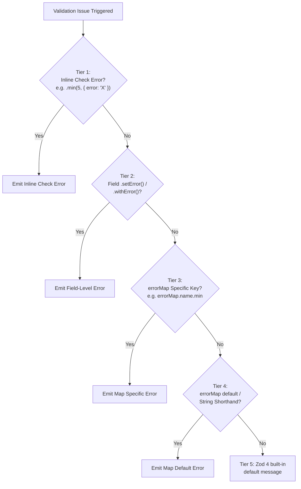

# Hybrid Architecture & Implementation Plan: Declarative Error Mapping for `refineSchema`

> **Target Package:** `@vacuus/drizzle-validators`  
> **Primary Files:** `src/refine.ts`, `src/zod-compat.ts`, `src/adapters/`  
> **Baseline:** `zod@^4.4.3`, `valibot@^1.5.0`, `typebox@1.1.0`  
> **Status:** Final Hybrid Plan — synthesized from four competing proposals  
> **Related Guarantee:** C1 non-contamination (`tests/bug-repro/refine-contamination.test.ts`)

---

## 0. Design Philosophy

This hybrid plan synthesizes the winning elements from all four proposals into a single, implementable specification. The guiding principles:

1. **Plan C's type system** — per-core-type key restriction with `FieldErrorMapForCore<T>` and the `ErrorMappedShape` invariant
2. **Plan B's implementation skeleton** — paste-ready `refineSchema` runtime body, `preserveInline` threading, and `EXPLICIT_SET_ERROR_BRAND`
3. **Plan A's precedence granularity** — 5-tier hierarchy and multi-validator algorithms
4. **Plan D's discipline** — fail-closed for unknowns, explicit scoping boundaries, no recursive element application

---

## 1. Public API

### 1.1 Overload Signatures

```ts
// Overload 1: Error map only (no shape modifications)
export function refineSchema<
  T extends z.ZodObject<any>,
>(
  baseSchema: T,
  errorMap: SchemaErrorMap<T["shape"]>,
): z.ZodObject<T["shape"]>;

// Overload 2: Rules callback only (existing signature, unchanged)
export function refineSchema<
  T extends z.ZodObject<any>,
  R extends RefinementCallbackResult<T["shape"]>,
>(
  baseSchema: T,
  refinementFn: (fields: RefinableShape<T["shape"]>, z: typeof import("zod")) => R,
): z.ZodObject<MergedRefinedShape<T["shape"], R>>;

// Overload 3: Rules callback + fallback error map
export function refineSchema<
  T extends z.ZodObject<any>,
  R extends RefinementCallbackResult<T["shape"]>,
>(
  baseSchema: T,
  refinementFn: (fields: RefinableShape<T["shape"]>, z: typeof import("zod")) => R,
  errorMap: SchemaErrorMap<MergedRefinedShape<T["shape"], R>>,
): z.ZodObject<MergedRefinedShape<T["shape"], R>>;
```

**Left-to-right ordering is a hard constraint** (from Plans A/C/D): `R` must be inferred from the callback before `SchemaErrorMap<MergedRefinedShape<...>>` can be checked.

### 1.2 Usage Examples

```ts
// ── Pattern 1: Error map only ──────────────────────────
const createAccountSchema = refineSchema(insertUsersSchema, {
  // String shorthand: sets `default` catch-all (from Plan B)
  username: "Username is mandatory",

  // Granular check mapping with typed keys (from Plan C)
  email: {
    required: "Please provide your corporate email",
    format: "Email address format is invalid",
    max: "Email cannot exceed 255 characters",
  },

  // Dynamic error functions (from Plans A/B)
  age: {
    required: "Age is required",
    min: (issue) => `You must be at least ${issue.minimum} years old`,
    int: "Age must be a whole number",
  },

  // Enum/literal field
  role: {
    invalid_value: "Selected role is invalid",
  },
});

// ── Pattern 2: Rules callback + fallback error map ─────
const registrationSchema = refineSchema(
  insertUsersSchema,
  (fields, z) => ({
    email: fields.email.as(z.email()),
    age: fields.age.min(21, { error: "VIP registration requires age 21+" }),
    confirmPassword: z.string().min(8),
  }),
  {
    email: {
      required: "Email is required",
      format: "Enter a valid work email",   // fallback; .as(z.email({error})) inline would win
    },
    age: {
      required: "Age is required",
      int: "Age must be an integer",
      min: "Default minimum age fallback",   // IGNORED: inline "VIP..." wins for .min(21)
    },
    // TypeScript autocomplete sees `confirmPassword` because it was returned by the callback
    confirmPassword: {
      required: "Please confirm your password",
      min: "Confirmation must be at least 8 characters",
    },
  }
);

// ── Pattern 3: .setError() accepting a FieldErrorMap (from Plan B) ──
const loginSchema = refineSchema(insertSchema, (fields, z) => ({
  email: fields.email.as(z.email()).setError({
    required: "Email is required",
    format: "Invalid email format",
  }),
}));

// ── Pattern 4: i18n with dynamic functions (from Plan A) ──
const localizedSchema = refineSchema(baseUsers, {
  email: {
    required: () => i18n.t("validation.email.required"),
    format: () => i18n.t("validation.email.format"),
    max: ({ maximum }) => i18n.t("validation.email.too_long", { max: maximum }),
  },
});
```

---

## 2. Type System (from Plan C + Plan A context types)

### 2.1 Error Message Type

```ts
/** Static string or dynamic callback receiving the raw Zod 4 issue payload */
export type ErrorMessage = string | ((issue: Record<string, any>) => string);
```

### 2.2 Unified FieldErrorMap (from Plan B's flat map + Plan C's per-core restriction)

```ts
/**
 * Granular error dictionary for a schema field.
 * Keys are the union of Zod 4 issue codes and check-kind aliases.
 */
export type FieldErrorMap = {
  /** Catch-all fallback for any unmapped error on this field */
  default?: ErrorMessage;

  // ── Core Type & Presence ──
  required?: ErrorMessage;
  null?: ErrorMessage;           // (from Plan B)
  invalid_type?: ErrorMessage;
  invalid_value?: ErrorMessage;

  // ── Size, Length & Numeric Bounds (aliases) ──
  min?: ErrorMessage;            // too_small: min_length, greater_than
  max?: ErrorMessage;            // too_big: max_length, less_than
  length?: ErrorMessage;         // length_equals
  int?: ErrorMessage;            // number_format (safeint/int)
  multiple_of?: ErrorMessage;

  // ── String Formats & Patterns ──
  format?: ErrorMessage;         // generic fallback for any string_format
  regex?: ErrorMessage;
  starts_with?: ErrorMessage;
  ends_with?: ErrorMessage;
  includes?: ErrorMessage;
  custom?: ErrorMessage;
} & {
  /** Specific format overrides: `email`, `uuid`, `url`, `ipv4`, etc. */
  [K in StringFormat]?: ErrorMessage;
};

export type FieldErrorInput = ErrorMessage | FieldErrorMap;
```

### 2.3 Per-Core-Type Key Restriction (from Plan C)

```ts
type StringAllowedKeys =
  | "default" | "required" | "null" | "invalid_type" | "invalid_value"
  | "min" | "max" | "length" | "format" | "regex" | "starts_with"
  | "ends_with" | "includes" | "custom" | StringFormat;

type NumberAllowedKeys =
  | "default" | "required" | "null" | "invalid_type" | "invalid_value"
  | "min" | "max" | "int" | "multiple_of" | "custom";

type BigIntAllowedKeys = NumberAllowedKeys;
type DateAllowedKeys =
  | "default" | "required" | "null" | "invalid_type" | "invalid_value"
  | "min" | "max" | "custom";

type EnumAllowedKeys =
  | "default" | "required" | "null" | "invalid_type" | "invalid_value" | "custom";

type ArrayAllowedKeys =
  | "default" | "required" | "null" | "invalid_type" | "invalid_value"
  | "min" | "max" | "length" | "custom";

type BooleanAllowedKeys =
  | "default" | "required" | "null" | "invalid_type" | "invalid_value" | "custom";

type GenericAllowedKeys = keyof FieldErrorMap;

export type FieldErrorMapForCore<T extends z.ZodTypeAny> =
  Partial<Record<AllowedErrorKeyForCore<T>, ErrorMessage>>;

type AllowedErrorKeyForCore<T extends z.ZodTypeAny> =
  DeepUnwrap<T> extends z.ZodString ? StringAllowedKeys :
  DeepUnwrap<T> extends z.ZodNumber ? NumberAllowedKeys :
  DeepUnwrap<T> extends z.ZodBigInt ? BigIntAllowedKeys :
  DeepUnwrap<T> extends z.ZodDate ? DateAllowedKeys :
  DeepUnwrap<T> extends z.ZodBoolean ? BooleanAllowedKeys :
  DeepUnwrap<T> extends z.ZodEnum<any> | z.ZodNativeEnum<any> | z.ZodLiteral<any> ? EnumAllowedKeys :
  DeepUnwrap<T> extends z.ZodArray<any> | z.ZodSet<any> ? ArrayAllowedKeys :
  GenericAllowedKeys;
```

### 2.4 Schema-Level Map

```ts
export type SchemaErrorMap<TShape extends Record<string, z.ZodTypeAny>> = {
  [K in keyof TShape]?: FieldErrorMapForCore<TShape[K]> | string;
};

export type MergedRefinedShape<
  TShape extends Record<string, z.ZodTypeAny>,
  R extends RefinementCallbackResult<TShape>,
> = Omit<TShape, keyof R> & {
  [K in keyof R]: K extends keyof TShape
    ? ResolveRefinedField<TShape[K], R[K]>
    : R[K] extends z.ZodTypeAny
      ? R[K]
      : never;
};
```

> [!IMPORTANT]
> `ErrorMappedShape<TShape, TMap> = TShape` (from Plan C): error mapping **never** alters `z.infer` types. The output type of `refineSchema` with an error map is identical to without one.

---

## 3. Precedence Architecture (from Plan A's 5-tier)



### Precedence Decision Matrix

| Scenario | Definition | Error Map | Input | Winner | Tier |
|:---|:---|:---|:---|:---|:---:|
| Inline check wins | `f.age.min(18, { error: "Inline" })` | `age: { min: "Map" }` | `15` | `"Inline"` | 1 |
| `.setError()` wins | `f.email.setError("Field error")` | `email: { format: "Map" }` | `"abc"` | `"Field error"` | 2 |
| Map specific key | `f.age.as(z.number().int())` | `age: { int: "Whole number" }` | `15.5` | `"Whole number"` | 3 |
| Map default/shorthand | `f.name` (required) | `name: "Name required"` | `undefined` | `"Name required"` | 4 |
| Zod native fallback | `f.name.min(3)` | `name: { max: "Too long" }` | `"a"` | Zod default | 5 |

---

## 4. Runtime Implementation

### 4.1 `hasInlineError` — The Precedence Backstop (from Plan C)

Add to `src/zod-compat.ts`:

```ts
/**
 * True when an error was EXPLICITLY authored on this def.
 * Uses own-property descriptor probe to distinguish user-authored
 * error functions from Zod's auto-generated getter accessors.
 */
export function hasInlineError(def: Record<string, any>): boolean {
  if (def[EXPLICIT_SET_ERROR_BRAND] === true) return true;
  const desc = Object.getOwnPropertyDescriptor(def, "error");
  // A getter is Zod's default (auto-generated locale error);
  // a data property (own function value) is user-authored.
  return desc !== undefined && "value" in desc && typeof desc.value === "function";
}
```

### 4.2 `EXPLICIT_SET_ERROR_BRAND` (from Plans B + C)

```ts
const EXPLICIT_SET_ERROR_BRAND = Symbol.for("drizzle-validators.explicit-set-error");
```

Set on clones produced by `.setError()` / `.withError()` so the map pass can detect them even after `.as()` transfers.

### 4.3 Check Error Resolution (from Plan B's dispatch + Plan C's dual-namespace)

```ts
function resolveCheckError(
  checkDef: Record<string, any>,
  map: FieldErrorMap,
): ErrorMessage | undefined {
  // Fine-grained check-kind key (highest priority within the map)
  switch (checkDef.check) {
    case "min_length":
    case "greater_than":
      return map.min ?? map.default;
    case "max_length":
    case "less_than":
      return map.max ?? map.default;
    case "length_equals":
      return map.length ?? map.default;
    case "multiple_of":
      return map.multiple_of ?? map.default;
    case "number_format":
      return map.int ?? map.default;
    case "string_format": {
      const fmt = String(checkDef.format ?? "");
      const specific = (map as Record<string, ErrorMessage | undefined>)[fmt];
      return specific ?? map.format ?? map.default;
    }
    case "custom":
      return map.custom ?? map.default;
    default:
      return map.default;  // fail-closed: unknown check types get default only (from Plan D)
  }
}
```

### 4.4 Core Def Error Handler (from Plan B's `dispatchCoreError` + Plan A's null handling)

```ts
function createDefErrorHandler(
  map: FieldErrorMap,
  existingDefError: ((issue: any) => string) | undefined,
  isRootFormatSchema: boolean,
): (issue: any) => string | undefined {
  return (issue: any): string | undefined => {
    // Tier 2: existing inline def error wins for its domain
    if (existingDefError) {
      if (isRootFormatSchema && issue.code === "invalid_format") {
        return existingDefError(issue);
      }
      if (!isRootFormatSchema) {
        return existingDefError(issue);
      }
    }

    // Tier 3/4: map dispatch
    if (issue.code === "invalid_type") {
      if (issue.input === undefined) {
        const m = map.required ?? map.invalid_type ?? map.default;
        if (m !== undefined) return evalErrorMessage(m, issue);
      } else if (issue.input === null) {
        const m = map.null ?? map.invalid_type ?? map.default;
        if (m !== undefined) return evalErrorMessage(m, issue);
      } else {
        const m = map.invalid_type ?? map.default;
        if (m !== undefined) return evalErrorMessage(m, issue);
      }
    } else if (issue.code === "invalid_value") {
      const m = map.invalid_value ?? map.default;
      if (m !== undefined) return evalErrorMessage(m, issue);
    } else if (issue.code === "invalid_format") {
      const fmt = String(issue.format ?? "");
      const specific = (map as Record<string, ErrorMessage | undefined>)[fmt];
      const m = specific ?? map.format ?? map.default;
      if (m !== undefined) return evalErrorMessage(m, issue);
    } else if (issue.code === "too_small") {
      const m = map.min ?? map.default;
      if (m !== undefined) return evalErrorMessage(m, issue);
    } else if (issue.code === "too_big") {
      const m = map.max ?? map.default;
      if (m !== undefined) return evalErrorMessage(m, issue);
    } else if (map.default !== undefined) {
      return evalErrorMessage(map.default, issue);
    }

    // Tier 5: fall through to Zod native
    return existingDefError ? existingDefError(issue) : undefined;
  };
}

function evalErrorMessage(
  msg: ErrorMessage,
  issue: Record<string, any>,
): string {
  return typeof msg === "function" ? msg(issue) : msg;
}
```

### 4.5 `applyFieldErrorMap` — Per-Field Application (from Plan C's structure + Plan B's clone path)

```ts
function applyFieldErrorMap(
  field: z.ZodTypeAny,
  errorConfig: FieldErrorInput,
  preserveInline: boolean,
): z.ZodTypeAny {
  if (!errorConfig) return field;

  // Normalize string shorthand to { default: string }
  const map: FieldErrorMap =
    typeof errorConfig === "string" ? { default: errorConfig } :
    typeof errorConfig === "function" ? { default: errorConfig } :
    errorConfig;

  const rawTarget = unwrapProxy(field);
  const { core, wrappers } = unwrapAll(rawTarget);
  const coreDef = getZodDef(core);
  if (!coreDef) return field;

  // Tier 2 check: if the whole field was branded by .setError(), skip entirely
  if (preserveInline && Reflect.get(core as object, EXPLICIT_SET_ERROR_BRAND) === true) {
    return field;
  }

  const overrides: Record<string, unknown> = {};

  // ── Per-check error overrides ──
  if (Array.isArray(coreDef.checks)) {
    let checksModified = false;
    const clonedChecks = coreDef.checks.map((check: any) => {
      const checkDef = getZodDef(check);

      // Tier 1: inline check error always wins (from Plan C's hasInlineError)
      if (!checkDef || (preserveInline && hasInlineError(checkDef))) {
        return check;
      }

      const fallbackMsg = resolveCheckError(checkDef, map);
      if (fallbackMsg !== undefined) {
        checksModified = true;
        return cloneZodCheck(check, typeof fallbackMsg === "function"
          ? fallbackMsg
          : () => fallbackMsg);
      }
      return check;
    });
    if (checksModified) overrides.checks = clonedChecks;
  }

  // ── Def-level error for type/required/null/value/format issues ──
  const existingDefError = typeof coreDef.error === "function" ? coreDef.error : undefined;
  const isRootFormat = typeof coreDef.format === "string";

  if (!(preserveInline && hasInlineError(coreDef))) {
    overrides.error = createDefErrorHandler(map, existingDefError, isRootFormat);
  }

  // ── Clone core if anything changed ──
  const nextCore = Object.keys(overrides).length > 0
    ? cloneSchemaWithDef(core, overrides, "error map application")
    : core;

  // ── Re-apply wrappers (from Plan C: wrapper preservation) ──
  return applyWrappers(nextCore, wrappers);
}
```

### 4.6 Updated `refineSchema` Runtime Body (from Plan B's skeleton)

```ts
export function refineSchema<
  T extends z.ZodObject<any>,
  R extends RefinementCallbackResult<T["shape"]> = {},
>(
  baseSchema: T,
  refinementOrErrorMap:
    | ((fields: RefinableShape<T["shape"]>, z: typeof import("zod")) => R)
    | SchemaErrorMap<T["shape"]>,
  maybeErrorMap?: SchemaErrorMap<MergedRefinedShape<T["shape"], R>>,
): any {
  // Validate arguments
  if (
    typeof refinementOrErrorMap !== "function" &&
    (!refinementOrErrorMap || typeof refinementOrErrorMap !== "object")
  ) {
    throw new DrizzleValidatorsError(
      "refineSchema expects a refinement callback function or an error map object as its second argument.",
    );
  }

  const nextShape: Record<string, z.ZodTypeAny> = { ...baseSchema.shape };

  // ── Step 1: Run refinement callback (existing behavior) ──
  if (typeof refinementOrErrorMap === "function") {
    const result = refinementOrErrorMap(
      createLazyShapeProxy(baseSchema.shape) as RefinableShape<T["shape"]>,
      z,  // pass the Zod namespace
    );
    if (!result || typeof result !== "object") {
      throw new DrizzleValidatorsError(
        "refineSchema callback must return an object mapping field names to schemas.",
      );
    }
    for (const [key, value] of Object.entries(result)) {
      if (value === undefined) continue;
      const schema = unwrapProxy(value);
      if (!isZodSchema(schema)) {
        throw new DrizzleValidatorsError(
          `Invalid refinement for field "${key}": expected a Zod schema instance, received ${typeof value}.`,
        );
      }
      nextShape[key] = schema;
    }
  }

  // ── Step 2: Apply declarative errorMap ──
  const errorMap =
    typeof refinementOrErrorMap === "function"
      ? maybeErrorMap
      : refinementOrErrorMap;

  if (errorMap !== undefined) {
    if (!errorMap || typeof errorMap !== "object" || Array.isArray(errorMap)) {
      throw new DrizzleValidatorsError(
        "refineSchema errorMap must be a plain object mapping field names to error messages.",
      );
    }
    for (const [key, errorConfig] of Object.entries(errorMap)) {
      if (errorConfig === undefined) continue;
      const targetField = nextShape[key];
      if (!targetField) {
        throw new DrizzleValidatorsError(
          `Cannot set error on unknown schema field "${key}".`,
        );
      }
      nextShape[key] = applyFieldErrorMap(
        targetField,
        errorConfig as FieldErrorInput,
        true,  // preserveInline: callback inline errors always win
      );
    }
  }

  // ── Step 3: Rebuild object (existing) ──
  return rebuildZodObject(baseSchema, nextShape);
}
```

---

## 5. `.setError()` / `.withError()` Extension (from Plan B)

The existing `.setError()` and `.withError()` proxy methods should also accept a `FieldErrorMap` object in addition to `string | ((issue) => string)`:

```ts
// In the refinement proxy:
setError(errorInput: FieldErrorInput): FieldProxy {
  if (typeof errorInput === "object" && errorInput !== null) {
    // Apply map to current field immutably
    return applyFieldErrorMap(this.schema, errorInput, false);
  }
  // Existing string/function behavior unchanged
  return setErrorOnField(this.schema, errorInput);
}
```

---

## 6. Multi-Validator Architecture (from Plan A)

> [!NOTE]
> `refineSchema` is Zod-only (it operates on `z.ZodObject` internals). The `SchemaErrorMap` **object shape** is target-agnostic, but the runtime application is adapter-specific.

### 6.1 Adapter Contract (from Plan D)

```ts
interface ValidatorErrorMappingAdapter<TSchema, TMap> {
  applyErrorMap(schema: TSchema, map: TMap): TSchema;
}
```

### 6.2 Valibot Application (from Plan A §5.1)

- Traverse `schema.entries`
- Unwrap `v.optional` / `v.nullable` to reach core
- For piped schemas: inspect `action.message === undefined` to determine if inline error exists
- Clone actions immutably: `{ ...action, message: resolvedMessage }`
- Return fresh object: `{ ...schema, entries: nextEntries }`
- Zero mutation (C1 safe)

### 6.3 TypeBox Application (from Plan A §5.2)

- Traverse `schema.properties`
- If `prop.error !== undefined`, preserve (inline wins)
- Compile `errorMessage` dictionary from map keys
- Clone property: `{ ...prop, errorMessage: { ...compiledErrors } }`

---

## 7. Scoping Boundaries (from Plan D)

The following are **explicitly out of scope for v1**:

| Feature | Status | Rationale |
|:---|:---:|:---|
| Nested dotted keys (`address.city`) | Deferred | Flat-per-field maps keep the API simple; can be added later |
| Array element error maps | Deferred | Element schemas have their own inline errors; recursive application would over-apply |
| Object-level `_object` key | Deferred | Object-level checks use existing inline errors |
| Adding validation checks via map | **Banned** | Error mapping is message customization, not rule addition |
| Importing Zod locales | **Banned** | Zero bundle bloat invariant |

---

## 8. Edge Cases & Guard Rails (merged from all plans)

| Edge Case | Behavior | Source |
|:---|:---|:---:|
| Unknown map field (2-arg form) | Compile-time error + runtime `DrizzleValidatorsError` | D |
| Undefined map value | No-op, treated as absent | D |
| Empty string `""` | Valid message, not treated as absent | D |
| Empty map `{}` | No-op, returns refined schema uncloned (fast path) | C |
| Map applied twice (idempotence) | Second pass sees branded checks → no further changes | C |
| Symbol-keyed shapes | Rejected by existing serialization guard | C |
| Transforms/codecs/pipes | Classify outer schema; do NOT rebuild by guessing internals | D |
| Optional field + `undefined` input | Outer wrapper intercepts → `required` never falsely triggered | A |
| Optional field + wrong-type input | Inner core fails → `invalid_type` error from map applies | A |
| `.as()` transferred checks with authored errors | `hasInlineError` → skipped by map | C |
| Multi-stage chaining | Layer 2 preserves Layer 1's mapped errors on untouched fields | A |
| Shared schemas / C1 contamination | Every changed check/def is cloned; base untouched | All |
| `null` input on non-nullable field | `map.null ?? map.invalid_type ?? map.default` | B |
| Unknown Zod check types | `map.default` only (fail-closed) | D |
| Dynamic error function throws | Error propagates; not caught or converted | D |
| Async refinement | Unaffected; map is synchronous construction | D |
| Lazy default/catch getters | Preserved via existing constructor/accessor path in `zod-compat.ts` | D |
| Strict/loose/catchall objects | Preserved via `rebuildZodObject` | D |

---

## 9. Test Plan

Create `tests/refine-error-map.test.ts`:

| # | Test Case | Pattern |
|:---|:---|:---|
| 1 | String catch-all overrides all errors on a field | 2-arg |
| 2 | Granular map dispatches correct message per issue code | 2-arg |
| 3 | Dynamic `(issue) => string` receives Zod issue and returns formatted string | 2-arg |
| 4 | `null` key handles null input on non-nullable field | 2-arg |
| 5 | Untouched fields keep Zod defaults | 2-arg |
| 6 | Callback adds new field; map styles it | 3-arg |
| 7 | Callback `.as()` replaces field type; map sees new type | 3-arg |
| 8 | Inline `.min(18, { error })` wins over `map.min` | 3-arg |
| 9 | `.setError("X")` wins over `map.required` | 3-arg |
| 10 | Root format schema `z.email({ error })` wins for `invalid_format`, map fills `required` | 3-arg |
| 11 | C1: two mapped refinements from same base produce independent errors | Contamination |
| 12 | C1: base schema is unchanged after mapped refinement | Contamination |
| 13 | Wrapper preservation: optional/nullable/default fields accept `undefined`/`null` and report mapped errors for invalid values | Wrappers |
| 14 | Multi-stage chaining: Layer 2 preserves Layer 1's mappings on untouched fields | Chaining |
| 15 | Empty map `{}` is a no-op | Edge |
| 16 | Unknown field in map throws `DrizzleValidatorsError` | Edge |
| 17 | Existing 2-arg callback API remains unchanged (no errorMap) | Backward |
| 18 | Tree-shaking: bundle size stays under threshold | Bundle |

---

## 10. Implementation Sequence

| Phase | Scope | Files |
|:---|:---|:---|
| **Phase 1** — Types | Add `ErrorMessage`, `FieldErrorMap`, `FieldErrorInput`, `FieldErrorMapForCore`, `SchemaErrorMap`, `MergedRefinedShape`. Wire overloads with `any`-erased runtime so type tests can be written first. | `src/refine.ts` |
| **Phase 2** — Precedence primitives | Add `hasInlineError` (own-property probe), `EXPLICIT_SET_ERROR_BRAND`, set brand in `setErrorOnField` | `src/zod-compat.ts`, `src/refine.ts` |
| **Phase 3** — Runtime core | Implement `resolveCheckError`, `createDefErrorHandler`, `evalErrorMessage`, `applyFieldErrorMap` | `src/refine.ts` |
| **Phase 4** — Integration | Update `refineSchema` runtime body with arg-dispatch and post-refine map application | `src/refine.ts` |
| **Phase 5** — `.setError()` extension | Accept `FieldErrorMap` in `.setError()` / `.withError()` | `src/refine.ts` |
| **Phase 6** — Tests | New `tests/refine-error-map.test.ts`, extend `refine-contamination.test.ts` | `tests/` |
| **Phase 7** — Exports & d.ts | Export new types from `src/refine.ts`; verify `dts-builder.ts` auto-propagation | `src/refine.ts`, `src/index.ts` |
| **Phase 8** — Adapter surfaces (future) | `applyValibotErrorMap` / `applyTypeboxErrorMap` behind same `SchemaErrorMap` contract | `src/adapters/` |

---

## 11. Non-Breaking Compatibility Guarantees

- **Zero breaking changes:** existing 2-arg `refineSchema(base, callback)` is fully preserved
- **Zero bundle impact:** error map code is only reachable through the new overload paths
- **Zero d.ts changes needed:** `dts-builder.ts` auto-propagates overloads from `refine.ts` exports
- **Zero `z.infer` changes:** `ErrorMappedShape<TShape, TMap> = TShape` — adding/removing an error map never changes inferred types
- **C1 guaranteed:** all application is clone-based; contamination regression suite is extended, not weakened
- **Tree-shaking safe:** no `import * as z`; only named Zod imports; no locale imports
