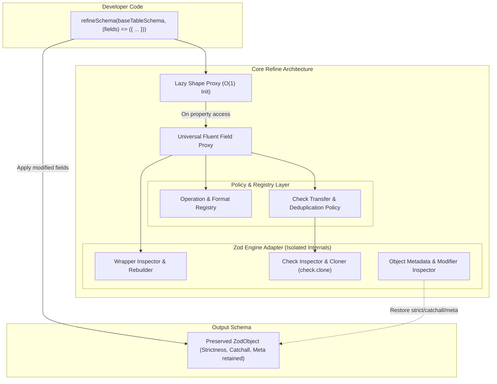

# Refactoring Plan: Robust, Scalable, and High-Performance `refineSchema`

> **File:** `suggestions/antigravity-refactor-refine-schema.md`  
> **Target:** `packages/drizzle-validators/src/refine.ts`  
> **Status:** Proposal & Architectural Specification  
> **Target Package:** `@vacuus/drizzle-validators`

---

## 1. Executive Summary

`refineSchema` is the primary application-level bridge in `@vacuus/drizzle-validators`, allowing developers to customize generated Drizzle ORM schemas with business validation rules, string format specializations, and localized error messages.

While the existing implementation provides basic proxying and wrapper preservation, a deep audit reveals **critical architectural bottlenecks, silent data corruption issues, and robustness bugs**:
1. **Chaining Collapse on Required Fields:** Method chaining breaks completely on non-wrapped fields (e.g. `fields.age.positive().setError(...)` or `fields.email.min(3).setError(...)` throws `TypeError: ... is not a function`).
2. **Constraint Corruption & Duplication:** Check transfer blindly duplicates checks, prevents users from loosening constraints via `.as()`, and generates duplicate error issues (e.g., `["New error", "Old error"]` on invalid formats).
3. **Silent Object Degradation:** Calling `refineSchema` on a `z.strictObject(...)` or an object with `.catchall(...)` silently strips strictness and drops the catchall schema.
4. **Type-vs-Runtime Divergence:** TypeScript types forcibly re-wrap replaced fields with original wrappers, causing compile-time types to claim a field is optional when runtime validation strictly requires it.
5. **O(N) Eager Overhead:** Every `refineSchema` call eagerly inspects and wraps all table columns in advance, introducing unnecessary CPU and memory allocation on large schemas.
6. **Hardcoded Dispatch Hub:** Format helpers are duplicated across multiple switch branches and types, omitting 17+ standard Zod 4 formats and preventing custom domain extensions.

This plan details a phased refactoring to transform `refineSchema` into a **modular, robust, type-sound, and high-performance** schema refinement engine.

---

## 2. Root Cause Analysis: Robustness & Scalability Flaws

### 2.1 Bug: Premature Target Unbinding (Method Chaining Collapse)
- **Location:** `packages/drizzle-validators/src/refine.ts` (lines 537–540)
- **Code:**
  ```ts
  if (prop in target) {
      const val = Reflect.get(target, prop, receiver);
      if (typeof val === "function") return val.bind(target);
  }
  ```
- **The Defect:** When a field is required (non-wrapped), `target === core`. Standard Zod methods (`min`, `max`, `trim`, `positive`, `int`, etc.) exist directly on `target`. Because `prop in target` evaluates to `true`, the proxy returns `val.bind(target)`—which executes raw Zod methods and returns an **unproxied** Zod instance.
- **Concrete Reproduction:**
  ```ts
  const base = z.object({ age: z.number(), email: z.string() });
  // Throws: TypeError: f.age.positive(...).setError is not a function
  refineSchema(base, (f) => ({
      age: f.age.positive().setError("Must be positive"),
      email: f.email.min(3).setError("Too short"),
  }));
  ```
- **Impact:** Method chaining only works by accident on `optional` or `nullable` fields because `.min()` doesn't exist on `ZodOptional`.

---

### 2.2 Bug: Constraint Duplication & Blocked Overrides in `transferChecks`
- **Location:** `packages/drizzle-validators/src/refine.ts` (lines 345–351)
- **Code:**
  ```ts
  if (checkDef.check === "string_format") {
      const fmt = checkDef.format;
      const isConstraint = CONSTRAINT_STRING_FORMATS.has(fmt);
      if (!isConstraint && targetFormat && fmt !== targetFormat) {
          continue;
      }
  }
  ```
- **The Defects:**
  1. **Duplicate Validation Errors:** When refining an email field using `f.email.asEmail({ error: "New error" })`, `fmt !== targetFormat` evaluates to `false` (both are `"email"`). The old email check is transferred onto the new email schema. When validation fails, Zod fires **both** checks, yielding duplicate issues:
     ```json
     ["New error", "Old email error"]
     ```
  2. **Inability to Loosen/Override Constraints:** If `base` has `z.string().min(5)` and the developer writes `.as(z.string().min(2))`, `transferChecks` appends the old `min(5)` check to the target. Strings of length 3 or 4 fail validation because `min(5)` was resurrected against the developer's intent.
  3. **Duplicate Limit Checks:** Calling `f.bio.as(z.string().max(20))` on a field that was `max(10)` creates two `max_length` checks (`max: 20` and `max: 10`), rendering the schema permanently constrained to 10.

---

### 2.3 Bug: Silent Base Object Degradation
- **Location:** `packages/drizzle-validators/src/refine.ts` (lines 600–603)
- **Code:**
  ```ts
  return object({
      ...baseSchema.shape,
      ...modifiedFields,
  }) as any;
  ```
- **The Defect:** Calling `object(...)` creates a fresh, bare `ZodObject` with default `strip` behavior.
- **Concrete Reproduction:**
  ```ts
  const strictBase = z.strictObject({ id: z.number() });
  const refined = refineSchema(strictBase, (f) => ({ id: f.id.setError("Invalid ID") }));
  // Expected: fails because 'extra' is unknown
  // Actual: SUCCEEDS! Strictness was silently erased.
  refined.safeParse({ id: 1, extra: "unwanted" }); // { success: true }
  ```
- **Impact:** Any object-level modifier applied to the base schema—including `.strict()`, `.passthrough()`, `.catchall(...)`, `.describe(...)`, and `.meta(...)`—is silently erased.

---

### 2.4 Bug: Type Soundness vs. Runtime Divergence
- **Location:** `packages/drizzle-validators/src/refine.ts` (lines 583–593)
- **Code:**
  ```ts
  [K in keyof R]: K extends keyof T["shape"]
      ? R[K] extends z.ZodTypeAny
          ? PreserveWrapper<T["shape"][K], DeepUnwrap<R[K]>>
          : T["shape"][K]
      : ...
  ```
- **The Defect:** TypeScript unconditionally applies `PreserveWrapper` to every field present in `T["shape"]`, regardless of what the user returned in `refinementFn`.
- **Concrete Reproduction:**
  ```ts
  const base = z.object({ bio: z.string().optional() });
  // Developer explicitly requires bio in this form:
  const refined = refineSchema(base, () => ({ bio: z.string().min(5) }));

  type Inferred = z.infer<typeof refined>;
  const sample: Inferred = {}; // TypeScript says this is VALID!

  refined.safeParse({}); // Runtime validation FAILS with "invalid_type: expected string"
  ```
- **Impact:** Critical type-soundness failure. TypeScript permits payloads that crash at runtime. Furthermore, there is no API method (such as `.unwrap()` or `.required()`) to explicitly remove wrapper layers.

---

### 2.5 Scalability: O(N) Eager Traversal & Allocation
- **Location:** `packages/drizzle-validators/src/refine.ts` (lines 594–597)
- **The Defect:** Every call to `refineSchema` loops over `Object.entries(baseSchema.shape)`, executes `unwrapAll(field)` (walking the wrapper chain), and creates a new `Proxy` for every column in the table.
- **Impact:** In databases with tables containing 50–100+ columns, refining a single field allocates 100+ Proxies and inspects 100+ defs up front. In multi-stage schema composition (`step1 -> step2 -> step3`), this overhead compounds linearly.

---

### 2.6 Scalability: Hardcoded Dispatch Hub & Boilerplate
- **The Defect:** `asEmail`, `asUrl`, `asUuid`, `asCuid2`, and `asUlid` are copy-pasted implementations in `wrapFieldProxy.get`, repeated in the `has` trap, and duplicated in `RefinedField`.
- **Impact:**
  - 17+ standard Zod 4 formats (`guid`, `cuid`, `nanoid`, `jwt`, `ipv4`, `ipv6`, `cidrv4`, `cidrv6`, `base64`, `base64url`, `emoji`, `ksuid`, `xid`, `e164`, etc.) are left without helper methods.
  - Adding a format or helper requires editing 4 disparate locations.
  - No plugin or extension point exists for application-specific formats (e.g., `asPhoneNumber`, `asSlug`).

---

### 2.7 Fragility: Unchecked Reliance on Zod 4 Internals
- **The Defect:** Direct accesses to `_zod.traits`, `_zod.constr`, `_def`, `checks`, and property descriptors are scattered across utility functions.
- **Misconception in Existing Code:** Line 158 claims `Zod 4 check instances do not expose .clone()`, causing manual constructor re-instantiation hacks. In reality, Zod 4 check instances implement `.clone(newDef)`.

---

## 3. Target Architecture & Design



### 3.1 Lazy Shape Proxy (`createLazyShapeProxy`)
Replace eager O(N) iteration with an on-demand Proxy over `baseSchema.shape`:
- **O(1) Initialization:** Proxy creation costs nothing until a field is accessed.
- **Cached Field Proxies:** Accessing `fields.email` wraps and caches the proxy for that key; untouched fields are never inspected or unwrapped.
- **Scalability:** Large schemas (100+ columns) execute in sub-millisecond time.

```ts
function createLazyShapeProxy(baseShape: Record<string, z.ZodTypeAny>): Record<string, any> {
    const cache = new Map<string, any>();
    return new Proxy(baseShape, {
        get(target, prop, receiver) {
            if (typeof prop !== "string" || !(prop in target)) {
                return Reflect.get(target, prop, receiver);
            }
            let fieldProxy = cache.get(prop);
            if (!fieldProxy) {
                fieldProxy = createFieldProxy(target[prop]);
                cache.set(prop, fieldProxy);
            }
            return fieldProxy;
        },
    });
}
```

---

### 3.2 Universal Fluent Field Proxy
Fix the chaining collapse bug by intercepting **all** function invocations on both `target` and `core`:
1. If the called method exists on `target` or `core` (e.g. `.min()`, `.positive()`, `.trim()`, `.refine()`):
   - Invoke the method on the appropriate target.
   - If invoked on `core`, re-apply extracted wrappers (`applyWrappers`).
   - **Crucial:** Always re-wrap the result in `createFieldProxy(...)`!
2. This guarantees that `.min(3).setError(...)` or `.positive().format("email")` works consistently across required, optional, and nullable fields.

---

### 3.3 Extensible Operation Registry
Decouple format helpers from Proxy code using an operation registry:

```ts
export interface FieldOperation {
    name: string;
    execute(context: FieldOperationContext, ...args: any[]): z.ZodTypeAny;
}

export class FieldOperationRegistry {
    private static operations = new Map<string, FieldOperation>();

    static register(op: FieldOperation) {
        this.operations.set(op.name, op);
    }

    static get(name: string): FieldOperation | undefined {
        return this.operations.get(name);
    }
}
```

- Standard string formats (`email`, `uuid`, `url`, `ipv4`, etc.) register once.
- Built-in aliases (`asEmail`, `asUuid`, `asUrl`, etc.) delegate directly to `registry.get("format").execute(ctx, formatName, params)`.
- Users can register application-specific formats:
  ```ts
  refineSchema.registerFormat("phone", (params) => z.string().regex(/^\+?[1-9]\d{1,14}$/, params));
  // Available immediately: fields.phone.format("phone") or fields.phone.as("phone")
  ```

---

### 3.4 Policy-Driven Check Transfer & Deduplication
Replace heuristic check transfers with a strict **Check Transfer Policy**:

1. **Format Check Rule:** If target schema already defines a format (e.g. `email()`, `uuid()`), **never** transfer non-constraint string formats from the source.
2. **Constraint Deduplication:** If target schema already has a check of the same type and kind (e.g., `target` has `min_length: 2` and `source` has `min_length: 5`), the **target check takes precedence**—do not append the source check.
3. **Explicit Override Control:** Add an optional control parameter to `.as()`:
   ```ts
   // Keeps wrappers, but discards old column checks in favor of the new definition
   fields.bio.as(z.string().min(2), { transferChecks: false });
   ```
4. **Leverage Zod 4 `check.clone()`:** Use official `check.clone(updatedDef)` instead of manual constructor instantiation.

---

### 3.5 Base Object Integrity Preservation
Retain the exact object properties and modifiers of `baseSchema`:

```ts
function reconstructObjectSchema<T extends z.ZodObject<any>>(
    baseSchema: T,
    newShape: Record<string, z.ZodTypeAny>,
): z.ZodObject<any> {
    const baseDef = (baseSchema as any)._zod?.def ?? (baseSchema as any)._def;
    
    // 1. Rebuild base object with merged shape
    let result = z.object(newShape);

    // 2. Restore strictness / unknown key policy
    if (baseDef?.unknownKeys === "strict" || baseDef?.type === "strictObject") {
        result = result.strict();
    } else if (baseDef?.unknownKeys === "passthrough") {
        result = result.passthrough();
    }

    // 3. Restore catchall
    if (baseDef?.catchall && baseDef.catchall._def?.type !== "never") {
        result = result.catchall(baseDef.catchall);
    }

    // 4. Restore description and metadata
    if (baseSchema.description) {
        result = result.describe(baseSchema.description);
    }

    return result as any;
}
```

---

### 3.6 Type System Soundness & Explicit Wrapper Controls
1. **Explicit Wrapper Controls on `RefinedField`:**
   - `.unwrap()`: Drops all outer wrappers (`optional`, `nullable`, `default`), returning the raw core field.
   - `.required()`: Removes `optional` and `exactOptional` while preserving nullability.
   - `.nonnull()` / `.nonnullable()`: Removes `nullable` while preserving optionality.
2. **Conditional Type Discrimination:**
   - Update `RefinementCallbackResult` to distinguish between a `RefinedField<T>` (which signals intention to preserve wrappers) and a bare `z.ZodTypeAny` (which indicates an explicit override):
   ```ts
   export type RefinementResult<TOriginalShape, R> = z.ZodObject<{
       [K in keyof TOriginalShape]: K extends keyof R
           ? R[K] extends IsExplicitOverride
               ? R[K] // Developer explicitly returned a new schema, do NOT force-wrap
               : PreserveWrapper<TOriginalShape[K], DeepUnwrap<R[K]>>
           : TOriginalShape[K];
   }>;
   ```

---

### 3.7 Callback Validation & Actionable Diagnostics
Validate callback results before passing them into Zod:
1. If `modifiedFields === undefined` (forgotten `return`), throw:
   `"[drizzle-validators] refineSchema callback must return an object of field refinements. Did you forget to return the fields?"`
2. If `modifiedFields[key] === undefined`, safely treat it as a no-op (or allow explicit deletion via a sentinel like `refineSchema.omit`).
3. If `modifiedFields[key]` is not a valid Zod schema, throw:
   `"[drizzle-validators] Invalid refinement for field '${key}': expected a Zod schema, received ${typeof value}."`

---

## 4. API Design: Dual-Surface Architecture (Fluent + Declarative)

To ensure maximum scalability and developer ergonomics, the refactored engine supports two complementary refinement surfaces sharing the same underlying `ZodEngineAdapter` and `FieldOperationRegistry`:

### 4.1 Surface A: Hardened Fluent Proxy (`refineSchema`)
Maintains 100% backward compatibility with existing code while offering robust chaining, deduplicated checks, and explicit wrapper unwrapping:

```ts
import { refineSchema } from "@vacuus/drizzle-validators/refine";

export const insertUserSchema = refineSchema(baseInsertSchema, (fields) => ({
    // Chaining works on required and optional fields alike
    age: fields.age.positive().max(120).setError("Must be between 1 and 120"),

    // Format specialization with deduplicated error issues
    email: fields.email.asEmail({ error: "Please enter a valid work email" }),

    // Explicit override without resurrected constraints
    bio: fields.bio.as(z.string().min(2), { transferChecks: false }),

    // Explicit wrapper control: convert an optional field into a required field
    avatarUrl: fields.avatarUrl.unwrap().asUrl(),
}));
```

### 4.2 Surface B: Declarative Descriptor API (`refine`)
For complex tables or developers preferring data-driven, schema-agnostic refinements without runtime Proxy traps:

```ts
import { refine } from "@vacuus/drizzle-validators/refine";

export const insertUserSchema = refine(baseInsertSchema, {
    // Registered format specialization
    email: { format: "email", error: "Please enter a valid work email" },

    // Constraint patch
    age: { check: z.number().positive().max(120), error: "Must be between 1 and 120" },

    // Full replacement (wrappers preserved by default)
    role: { replace: z.enum(["admin", "user", "editor"]) },

    // Explicit unwrapping
    avatarUrl: { format: "url", required: true },
});
```

Both surfaces share:
- The **same check deduplication engine**.
- The **same format and operation registry**.
- The **same base object modifier preservation** (`strict`, `catchall`, `meta`).
- The **same multi-validator foundation** (making it straightforward to expose Valibot/TypeBox appliers when requested).

---

## 5. Proposed Public API Enhancements

```ts
export type RefinedField<T extends z.ZodTypeAny> = T & {
    // --- Error Overrides ---
    setError(message: string): RefinedField<T>;
    withError(message: string): RefinedField<T>;

    // --- Format Specializations ---
    format(formatName: StringFormat, params?: FormatParams): RefinedField<T>;
    asEmail(params?: FormatParams): RefinedField<T>;
    asUrl(params?: FormatParams): RefinedField<T>;
    asUuid(params?: FormatParams): RefinedField<T>;
    asCuid2(params?: FormatParams): RefinedField<T>;
    asUlid(params?: FormatParams): RefinedField<T>;
    asIpv4(params?: FormatParams): RefinedField<T>;
    asIpv6(params?: FormatParams): RefinedField<T>;
    asJwt(params?: FormatParams): RefinedField<T>;
    asNanoid(params?: FormatParams): RefinedField<T>;

    // --- Schema Replacement ---
    as<U extends z.ZodTypeAny>(
        newCoreSchema: U,
        options?: { transferChecks?: boolean }
    ): RefinedField<U>;

    // --- Explicit Wrapper Controls ---
    unwrap(): RefinedField<DeepUnwrap<T>>;
    required(): RefinedField<RemoveOptional<T>>;
    nonnullable(): RefinedField<RemoveNullable<T>>;
};
```

---

## 6. Phased Implementation Roadmap


### Phase 0: Baseline & Regression Pinning
- Add reproduction tests for every bug identified in Section 2:
  - Required field chaining failure (`positive().setError()`).
  - Duplicate email error issues (`["New error", "Old error"]`).
  - Constraint override failure (`min(5)` resurrected over `min(2)`).
  - Strict object loss and catchall loss.
  - Type-vs-runtime optionality divergence.

### Phase 1: Zod Engine Adapter & Universal Proxy Interception
- Create `src/refine/engine.ts` to isolate all Zod 4 internal reads (`_zod`, `def`, `traits`, `check.clone`).
- Refactor `wrapFieldProxy` to intercept all method calls on both `target` and `core`, ensuring every method returns a proxied schema.
- Verify that required field method chaining passes.

### Phase 2: Lazy Shape Proxy & Object Integrity
- Implement `createLazyShapeProxy` in `src/refine/lazy-proxy.ts`.
- Implement `reconstructObjectSchema` to retain `strict`, `passthrough`, `catchall`, `describe`, and metadata.
- Verify that large schemas benchmark significantly faster and strictness survives.

### Phase 3: Check Deduplication & Transfer Policy
- Implement `transferChecksWithPolicy`:
  - Check deduplication (target check wins).
  - Skip non-constraint format checks when target defines a format.
  - Implement `{ transferChecks: false }` option on `.as()`.
- Verify that duplicate error issues and resurrected constraints are eliminated.

### Phase 4: Operation Registry & Complete Format Suite
- Implement `FieldOperationRegistry`.
- Register all 22+ Zod 4 string formats and common numeric operations.
- Turn `asEmail`, `asUrl`, etc., into one-line delegates.

### Phase 5: Type-System Alignment & Explicit Wrapper Modifiers
- Implement `.unwrap()`, `.required()`, and `.nonnullable()` runtime methods.
- Update `refineSchema` return types so explicit schema replacements are not forced into original wrappers.

### Phase 6: Callback Validation & Actionable Diagnostics
- Add guarded checks on `refinementFn` return values.
- Provide descriptive error messages identifying offending field keys.

---

## 7. Verification & Test Matrix

| Test Suite | Verification Target |
| :--- | :--- |
| `tests/refine-chaining.test.ts` | Required fields support chaining: `.positive().setError()`, `.min().max().setError()`. |
| `tests/refine-dedup.test.ts` | `.asEmail()` on existing email generates exactly 1 issue on invalid input. |
| `tests/refine-override.test.ts` | `.as(z.string().min(2))` successfully loosens base schema's `min(5)`. |
| `tests/refine-object-integrity.test.ts` | Strict objects reject unknown keys after refinement; catchall validators persist. |
| `tests/refine-soundness.test.ts` | Explicitly requiring an optional field fails empty object in runtime AND TypeScript. |
| `tests/refine-lazy-perf.test.ts` | Schemas with 200 columns initialize in O(1) time without evaluating unreferenced fields. |
| `tests/refine-diagnostics.test.ts` | Missing return or returning non-schema values throws actionable errors with field names. |

---

## 8. Non-Breaking Compatibility Guarantee

- **Zero Breaking Changes for Valid Code:** All existing valid calls to `refineSchema` (`f.email.asEmail()`, `f.age.min(18)`, `f.id.setError("...")`) will continue to function identically with improved performance and deduplicated errors.
- **Tree-Shaking Safety:** `refine.ts` will continue to use named modular imports from `zod` to avoid bundling unneeded Zod internals or locales.
- **Dual Export Stability:** Both ESM and CJS builds will remain fully supported under `@vacuus/drizzle-validators/refine`.
